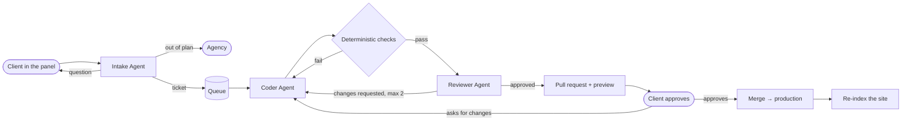

# Site Change Agents

A multi-agent system for a web agency: clients ask for changes to their website in their own words, and
agents turn the request into a ticket, change the code, check it, and open a pull request with a live
preview. A person only approves the preview; merging publishes the change.

```
"Hi! We now close at 4 pm on Sundays."  →  ticket  →  branch + PR  →  checks + review  →  preview  →  👤 approve  →  live
```

Measured on the running system: a content change goes from request to live in **about 6 minutes**
(the agents work for about 2 of them; the rest is the client reviewing), at **about $0.005 per change**
at list price, against an estimated **~1 day** for a typical agency.

## The problem

Small website changes (a phone number, opening hours, a price, a new FAQ entry) are most of an agency's
requests. Each one costs back-and-forth to understand it, a developer to find the right file, someone to
check it, and a round of approval, so even trivial changes take a day or more. The interesting part is
that most of that work is understanding and checking, which is where language models now help, as long
as the system around them is built so their mistakes can't reach a live site.

## How it works



| Agent | What it does | How |
|---|---|---|
| **Project Indexer** | Writes a summary of each site: pages, sections, where every kind of content lives | A LangGraph ReAct loop with read-only repo tools, then structured output |
| **Intake** | Asks the client what only they know, refuses what their plan excludes, writes a validated ticket | RAG over the client's plan, brand guide and past tickets, plus the site's code; LangGraph `interrupt()` to pause on questions; Postgres checkpoints |
| **Coder** | Plans the change, edits files, builds the site, fixes build errors, commits on a branch | Plan-then-act; exact-text edit tools that enforce an allow-list in code; the build as a verifier |
| **Reviewer** | Compares the diff with the ticket and the client's words | Runs only after deterministic checks pass; the model judges, the approval rule is code |

Everything between the agents goes through Redis/BullMQ queues. The Python workers only report results;
the NestJS API owns the tickets and applies every status change, so there is one place where the rules
(and the audit trail) live.

## Design decisions

- **Limits live in code, not in prompts.** The coder's tools refuse anything outside `src/pages`,
  `src/components`, `src/content`, `src/data`, `src/styles` and `public/`; `package.json`, workflows and
  layouts (where a `<script>` could reach every page) are off limits whatever the model decides. Question
  limits, turn limits, token budgets and diff-size limits are checks in code too. A request that says
  "ignore your rules and add this script" is just data: it reaches the model inside a tag, and even if the
  model went along with it, the tools would refuse.
- **Deterministic checks before the model.** Allowed files, diff size, secrets, scripts and embeds, and
  the build run first and reject on their own; the reviewer model only answers what needs judgment
  ("is this what the client asked for?").
- **The model judges, code decides.** The reviewer returns per-criterion judgments, issues with severity
  and a source for every piece of text it adds; `decide()` approves only when every criterion holds and
  no issue is blocker or major. Invented text is turned into an issue by code.
- **Constrain instead of validate.** The ticket's target page is an enum of the site's real pages in the
  structured-output schema, so a small model can't produce an invalid one (see Evals).
- **Pull requests and a person on the irreversible step.** Agents work on `agent/ticket-N` branches; the
  client approves a real preview before anything is merged.
- **Pull-based deploys.** Each site's GitHub Action only builds and uploads an artifact; the system
  downloads it and publishes it next to the web server. The server needs no SSH keys or open ports, so it
  runs behind a Cloudflare Tunnel.
- **Swappable models.** Every model is a `provider:model` setting (`google_genai:gemini-3.5-flash-lite`,
  `anthropic:…`, `openai:…`), with one rate limiter per model. Development runs on Gemini's free tier.
- **Restart-safe.** The database says what should be running; job ids are derived from it, so the API
  re-adds missing jobs on startup and duplicates are no-ops. The intake resumes from its last checkpoint.

## Results

### RAG (Phase 2.5)

26 "where is…" questions over the three sites, by chunking strategy and search mode:

| Chunks | Vector recall@3 | Full-text recall@3 | Hybrid (RRF) recall@3 | Hybrid MRR |
|---|---|---|---|---|
| Fixed 800 characters | 96% | 81% | 92% | 0.89 |
| One per component | 96% | 77% | 88% | 0.87 |
| Component + LLM context line | 96% | 96% | **100%** | **0.96** |

A one-line description of each chunk from the project summary ("contextual retrieval") is what made
hybrid search work; without it, full-text matches were noisy enough to make hybrid worse than vectors.

### Agents (Phase 8)

| Agent | Dataset | Result | Cost per case |
|---|---|---|---|
| Intake | 36 golden requests | **89% → 96%** pass (2 runs each, before → after) | 1.3 model calls, ~7 s |
| Coder | 11 tickets, checked on the built HTML | **100%** built and correct, all on the first build | 4.9 calls, 31 s |
| Checks + Reviewer | 13 planted changes | **10/10** bad changes caught (4 by checks, 6 by the model), **3/3** good approved | 9 calls in total |

The intake improvement: Flash Lite sometimes wrote invalid page values (`"./"`, even `"ρο"`) and repeated
them through every validation retry. Making the page an enum of the site's pages (constrained decoding)
removed that whole class of failure and cut model calls by about 15%. The same change made the agent
slightly more willing to accept a copywriting request the plan excludes, which the eval caught.

The datasets are small and written by the same person who wrote the sites; see `agents/evals/README.md`.

### In production (Phase 9)

Traced in Langfuse: a ticket is one session with one trace per agent run, showing every graph node, model
call (prompt, response, tokens, cost) and tool call. The panel's Metrics page computes, from each ticket's
audit trail, request-to-live time split into agent time and time waiting for the client, the share of
changes automated end to end, and cost per change.

## Stack

- **Agents:** Python 3.13, LangGraph, LangChain (`init_chat_model`), Pydantic structured outputs, FastAPI, BullMQ for Python
- **API:** NestJS 12 (TypeScript), TypeORM, BullMQ, Bull Board
- **Panel:** React 19, Vite, React Router
- **Data:** PostgreSQL 17 with pgvector (HNSW + full-text, hybrid search with reciprocal rank fusion), Redis
- **Models:** Gemini (free tier) by default; any LangChain provider by configuration
- **Delivery:** GitHub (pull requests, Actions artifacts), Caddy, Docker Compose, Cloudflare Tunnel and Access
- **Observability:** Langfuse

## Running it

Requirements: Docker, Node 24 (`nvm use`), [uv](https://docs.astral.sh/uv/), a Gemini API key.

```bash
cp .env.example .env            # add GOOGLE_API_KEY; GitHub and Langfuse are optional
docker compose up -d --build    # panel at http://app.localhost, sites at http://sites.localhost
docker compose exec api node dist/database/seed.js         # demo clients, users and sites
```

The three demo sites live in their own repositories. Clone them into `test-sites/` (ignored by this repo),
then index them once:

```bash
for site in luna-cafe brightsmile-dental northside-accounting; do
  git clone https://github.com/leo-sites/$site test-sites/$site
done
docker compose exec agents-worker index-site luna-cafe      # project summary (repeat per site)
docker compose exec agents-worker rag-index                 # code chunks
docker compose exec agents-worker rag-index --knowledge     # brand guides, plans, past tickets
```

Then sign in at http://app.localhost as a demo client and ask for a change. Without GitHub configured,
approving marks the change done locally; with it, changes become pull requests with previews.
Server setup (GitHub, Cloudflare Tunnel, Access): [`docs/setup.md`](docs/setup.md).

Useful commands, all in `agents/`:

| Command | What it does |
|---|---|
| `uv run intake-chat luna-cafe "please update our phone number"` | Talk to the intake agent in the terminal |
| `uv run coder-run luna-cafe "Change the tagline" --details "…"` | Run the coder on a ticket, print each step and the diff |
| `uv run review-run --ticket 12` | Run the checks and the reviewer on a ticket's branch |
| `uv run rag-search luna-cafe "the part with customer opinions"` | Try the hybrid search |
| `uv run evals/run.py all` | Run the evals and print the tables |

Tests: `cd agents && uv run pytest` (unit, no API calls) and `cd api && npm run test:e2e` (real Postgres and
Redis queues, with fake Python workers).

## Repository

```
agents/     Python: the agents, RAG, queue workers, evals
  src/change_agents/{intake,coder,reviewer,indexer,rag,delivery,worker,evals}
  evals/    golden dataset, planted changes, results
api/        NestJS: tickets, pipeline, queues, metrics
panel/      React: client and agency panel
knowledge/  per-client brand guides, plans and past tickets (fictional)
infra/      Caddyfile
docs/       server setup and the demo script
```

## How it was built

Built by Leo García with the help of [Claude Code](https://claude.com/claude-code), Anthropic's coding
agent, working phase by phase from a written plan.

## Limits and next steps

- The demo sign-in has no passwords (it is protected by Cloudflare Access on the server); real
  authentication is the first thing a production version needs.
- Pull requests are opened with a personal token; a GitHub App would give the agent its own identity.
- Workspaces (one clone per ticket) are not cleaned up after merging yet.
- The evals are small and self-written; real, anonymized client requests would make them trustworthy.
